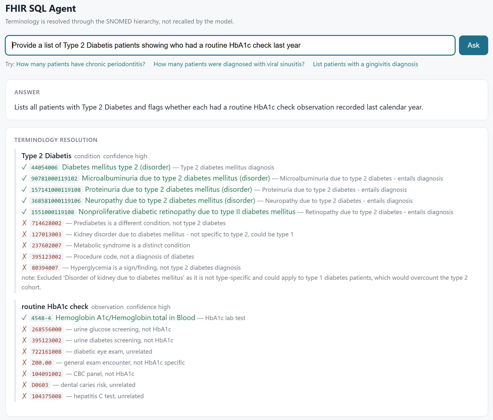
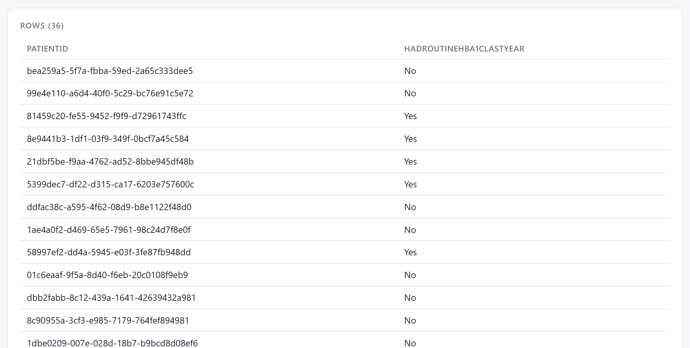

# FHIR SQL Agent

Ask a FHIR repository a clinical question in English, and be able to check the answer.

A natural-language agent over FHIR R4, built **entirely on InterSystems IRIS for Health** —
FHIR SQL for the data, vector search for the terminology, and an Interoperability production
as the agent runtime. The only component outside IRIS is a small SapBERT sidecar.

```
docker compose up -d
```



---

## What problem it solves

A model asked to write `WHERE Code = '...'` has to **recall** the code, and recall fails
*silently* — the query parses, executes, returns a plausible number, and nothing says the
codes were invented. Published measurements put this at **48.6% nonexistent codes** in one
study, and **79 of 84 cohort definitions returning no patients** in another.

So this agent never lets a model recall a code. Terminology resolution is an explicit,
traced pipeline stage, and every decision it makes is recorded with a reason — which is the
screenshot above.

## The pipeline

```
question ──► Agent.Service ──► Agent.Process ──┬──► LLM.Extract   1. stem + context
 (CSP page)   business          orchestrator    │
              service                           ├──► Embed.Op      2. SapBERT, 768-d   ◄─┐
                                                │                                        │ per
                                                ├──► Vector.Op     2. VECTOR_COSINE      │ concept
                                                │                                        │
                                                ├──► LLM.Rerank    4. keep/drop + why  ◄─┘
                                                │
                                                └──► LLM.SQL       5. SQL over the projection
                                                         │
                                               SqlGuard ─┴─► IRIS executes ──► rows + audit trail
```

Stage 3 — `$expand` / `$subsumes` / RxNav expansion — is implemented in
`Terminology.Client` but not yet wired into the orchestrator. See the article's §9.

`Embed.Op` and `Vector.Op` are business operations rather than inline method calls
**specifically** so that each appears in the Interoperability trace with its own request and
response. The message log *is* the audit record.

## Three results from one traced run

Measured on this deployment, not quoted — the full trace is in the article.

- **No similarity threshold can define a clinical cohort.** Asked for type 2 diabetes,
  *Prediabetes* (118 patients) scores **0.5717** while a genuine cohort member,
  *Nonproliferative retinopathy due to type II diabetes*, scores **0.5231**. There is no cut
  point that keeps the right codes and excludes the wrong one.
- **Cosine top-1 is the wrong answer.** Asked for "a routine HbA1c check", the nearest
  neighbour is *urine screening for glucose*; the correct LOINC code ranks **third**.
- **The platform costs under 1% of the wall clock.** Two embeddings, two vector searches, the
  guard and the execution together take ~220 ms of 26.2 s. The rest is four model calls.

And the consequence that matters: resolving the cohort properly rather than with
`LIKE '%diabet%'` moves a reported quality indicator from **65.6% to 52.8%** — and takes 28
non-diabetic patients off a nurse's call list.



## Why IRIS

| the architecture needs | IRIS supplies |
|---|---|
| a FHIR R4 repository | the FHIR server, same namespace |
| a flat SQL target over it | FHIR SQL projection |
| ANN search over embedded terminology | `VECTOR(DOUBLE,768)` + `AS HNSW` + `VECTOR_COSINE` |
| retrieval joined to clinical facts | one `SELECT`, one engine, one transaction |
| an agent runtime | an Interoperability production — typed messages, per-stage settings, pool, retry, resend |
| a durable trace of every step | the message bank |
| a key store | a Credentials entry |
| a web tier | a CSP page |
| *a biomedical text encoder* | *not in the box — SapBERT in a sidecar, 109M params, CPU* |

## Getting started

Everything is under [`iris/`](iris/):

| | |
|---|---|
| **[iris/README.md](iris/README.md)** | build notes, the quickstart, measurements, and the platform gotchas that cost real time |
| **[iris/ARTICLE_DC.md](iris/ARTICLE_DC.md)** | the write-up: how the field got here, the architecture, and one question traced through 18 messages |
| **[iris/synthea/README.md](iris/synthea/README.md)** | how the synthetic data was generated, and its provenance |

```bash
cd iris
cp setup/password.txt.example setup/password.txt     # then edit it
docker compose up -d
docker exec fhirsqlllm iris session IRIS -U %SYS \
  "##class(INT.FHIRSQLLLM.Setup.Installer).Run()"
```

Then generate the data, build the projection and the terminology index — the full sequence is
in [iris/README.md](iris/README.md#quickstart).

Chat page: `http://localhost:52773/csp/healthshare/fhirsqlllm/INT.FHIRSQLLLM.UI.Chat.cls`

## Data and safety

All data is **synthetic**, generated with [Synthea](https://github.com/synthetichealth/synthea)
— 337 patients, no PHI, no real patient data at any point.

No patient data reaches a model: the extract stage sees the question, the rerank stage sees
candidate *concept names*, and results are never sent anywhere. The API key lives in an IRIS
Credentials entry and is handed to the sidecar through a shared volume — never in source, a
setting, a command line or the process list.

`Agent.SqlGuard` allows a single read-only `SELECT` and nothing else.

## Licence

[MIT](LICENSE). Third-party terms — including the SNOMED CT and CDT restrictions that matter
if you extend this — are listed in [iris/README.md](iris/README.md#licence).

---

Built on IRIS for Health 2026.1 Community.
